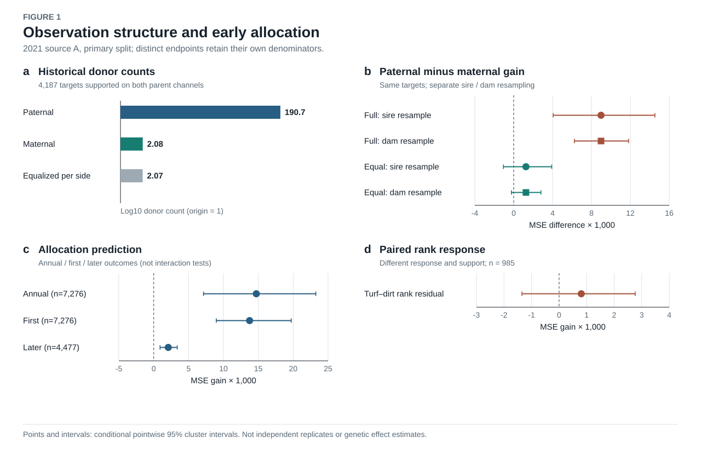
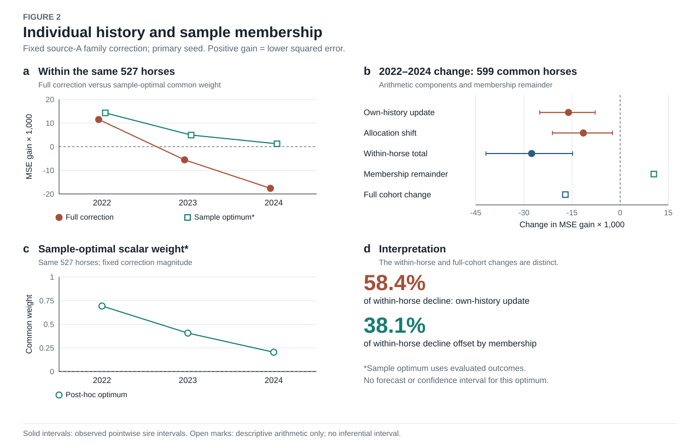
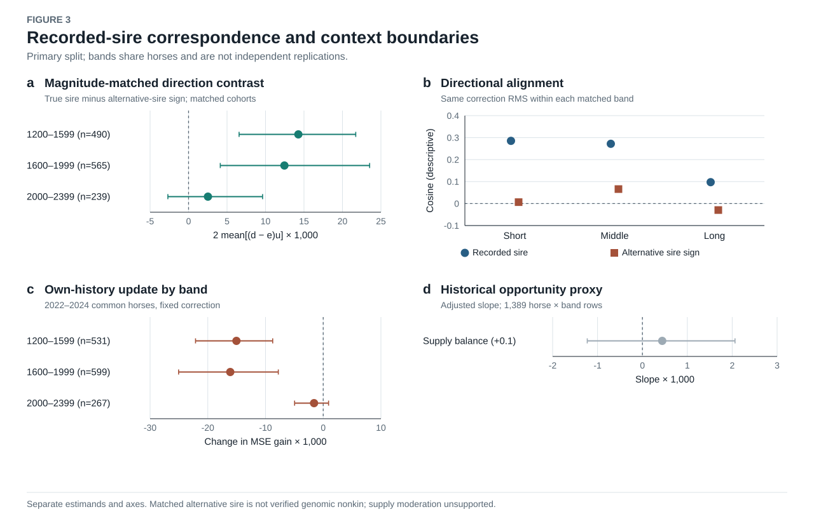
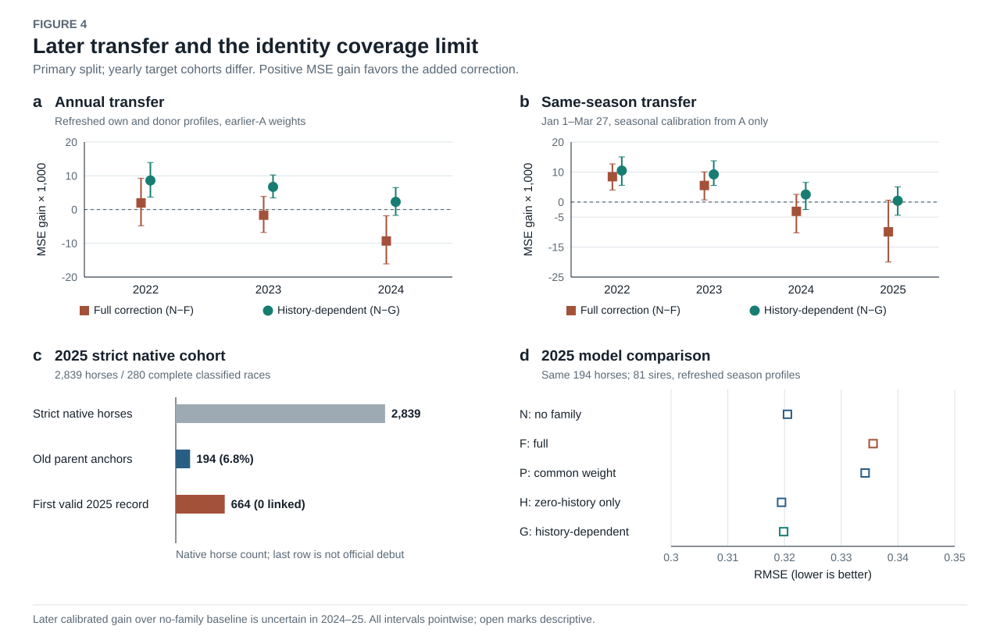

# Main figure drafts: source-locked aggregate visualizations

25 November 2026. Four vector SVGs derived from the pinned original anonymous aggregate receipts by [Node generator](../../../../scripts/render_context_information_figures.mjs). Re-run with `node scripts/render_context_information_figures.mjs`; use `--check` to compare committed files. No raw records, no new statistical fits, no invented confidence intervals. Main seed 20261124. [Numeric parity](numeric_parity.json) checks 41 selected numerical identities and claims. This is an aggregate-receipt consistency audit, not independent raw-data reproduction or full artifact extraction. Layout is a draft, journal export and visual review still required.

## Figure 1

[figure_1_observation_structure.svg](figure_1_observation_structure.svg)

## Figure 2

[figure_2_longitudinal_substitution.svg](figure_2_longitudinal_substitution.svg)

## Figure 3

[figure_3_identity_alignment.svg](figure_3_identity_alignment.svg)

## Figure 4

[figure_4_transfer_and_coverage.svg](figure_4_transfer_and_coverage.svg)

Legend: intervals are the original conditional pointwise cluster intervals; distinct endpoint scales are explicit. Open marks indicate descriptive quantities with no interval. Equalized parent count bars are on a log10 scale from one; equalized donor count does not establish equal genetic contribution. All figures show a selected primary split; the evidence receipts preserve other splits and negative/HOLD tests. Sample-optimal weights are computed using evaluated outcomes. Population membership is observation membership. Figure 4 coverage is not a complete national census, and first valid record in 2025 is not official debut.
